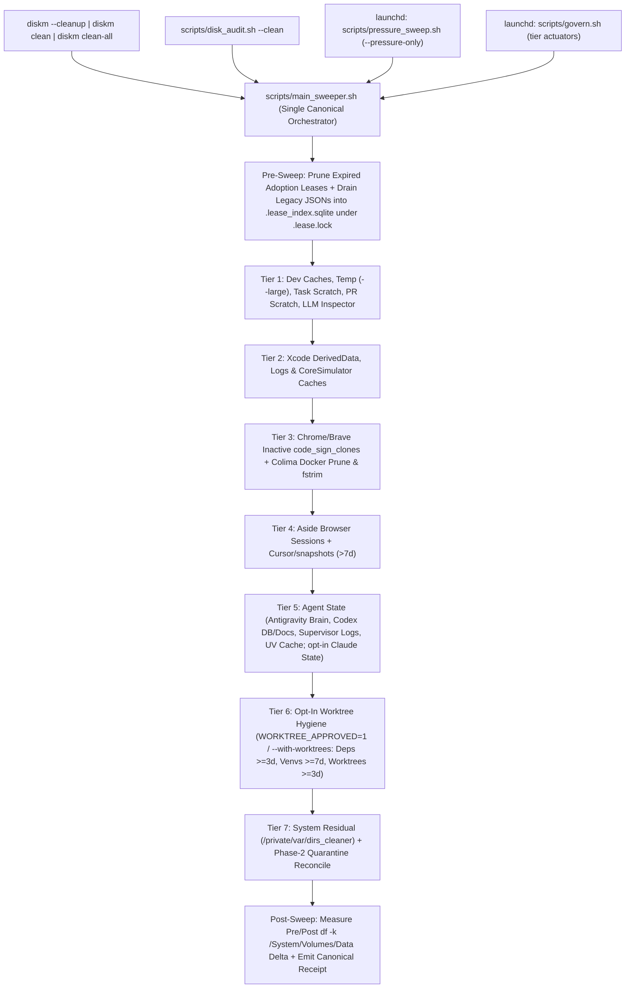

# Disk Magician Unified Cleanup (`diskm --cleanup`) & Fast C14 Governor Redesign

- **Date:** 2026-10-17
- **Author:** Antigravity (`gemini-4-argon`)
- **Status:** Proposed Design (`/sq` Superpowers Quick Specification — Finalized after `/advice` Review)
- **Repository:** `/Users/jleechan/projects_other/worktree_dropbox` (`jleechanorg/disk_magician`)
- **Related PRs:** `#184` (`158669a`), `#186`, `#187` (`59c4a3d`), `#188`–`#202`

---

## 1. Problem Statement & 14-Day Empirical Root-Cause Audit

Between `2026-10-03` and `2026-10-17` (14 days), the user had to manually prompt coding agents across **7 major disk-emergency sessions** (Oct 4, Oct 6, Oct 8, Oct 9, Oct 11, Oct 15, Oct 17) to diagnose and reclaim 50–150+ GiB of obvious, rebuildable or stale scratch space. Even after merging the **Staged Disk Governor & C14 Quarantine / Lease-Reap system** (`PR #184` @ `158669a` and `PR #187` @ `59c4a3d`, deployed as `0.2.236`), free space dropped to `26.7 GiB` on `2026-10-17` and routine sweeps reported `9 failures` with `degraded` health.

Empirical inspection of `/Users/jleechan/.disk_magician_state/receipts/*.json`, `/Users/jleechan/.disk_magician_state/govern_sched.json`, `/Users/jleechan/.disk_magician_state/worktree_leases/`, and the CLI/script dispatch chain identified **two classes of root causes**:

### 1.1 Why the New Staged Disk Governor & C14 Quarantine System (`PR #184` / `PR #187`) Was Not Helping in Production

1. **`birth_audit.sh` Lease Explosion (`16,839–21,000+` JSON files) + `O(N_leases)` Per-Candidate Scan**:
   - `scripts/birth_audit.sh` iterated over every child inside non-container `/private/tmp/<dir>` directories (`disk_magician-j5zg`, fixed in PR #200) and never pruned expired or vanished `birth-audit` adoption leases (`disk_magician-q39q`, fixed in PR #190), accumulating `16,839+` JSON lease files in `/Users/jleechan/.disk_magician_state/worktree_leases/`.
   - Every single `c14_remove` / `quarantine_remove` invocation spawned `python3 scripts/c14_probe.py lease-scan`, which opened, parsed, and SHA256-hashed all `16,839` lease files (`~1.5–3.0s` per candidate). Across 100+ candidates in a single sweep, lease scanning alone consumed `150–300s`.
2. **`E2BIG` (`ARG_MAX`) Cursor Save Crash (`cursor-save-failed`, `rc=126`)**:
   - `scripts/lib/actuator_deadline.sh`, `scripts/worktree_reap.sh`, and `scripts/lib/scratch_budget.sh` passed ~`1.28 MiB` of serialized candidate/lease cursor JSON via `sys.argv` to `python3 -c`, exceeding macOS `ARG_MAX` (`1 MiB`) and crashing `govern_worktrees` on every tick (`06:35`, `07:53`, `09:05`, `10:12`, `11:09 PDT` on `2026-10-17`; fixed in PR #193).
3. **Per-File Synchronous `os.fsync()` Storm in C14 Quarantine (`600s STEP_TIMEOUT`)**:
   - Removing a single candidate via `c14_remove` -> `quarantine_remove` called `update_sidecar()` -> `os.fsync()` **twice per individual unlinked file** in `quarantine_rename.py` (`phase2`).
   - On a 5,000-file directory (`node_modules`, `.venv`, or Playwright browser cache), `10,000` synchronous `fsync()` calls guaranteed a `600s` `STEP_TIMEOUT` (`hard_stop` in `main_sweeper.sh`).
4. **Phase-1 Quarantine & Same-Volume `_disk_magician_archive` Free `0 Bytes` on `df`**:
   - Phase-1 quarantine (`rename` into `.dm-quarantine`) and `cleanup_tmp.sh --large` (`mv` into `/private/tmp/_disk_magician_archive/<ts>`) are same-volume APFS renames (`0 bytes` freed on `df`).
   - Furthermore, `cleanup_tmp.sh` archived directories without pre-checking `artifact_removal_verdict` (`disk_magician-archive-same-volume-regrowth-03bn`, PR #192) and wrote `"retention": 0` for non-E2/E3 dirs, which `c14_archive_origin` permanently rejected with `kept:archive-identity` while hardcoding a `1440m` (24h) floor that ignored the 4h pressure setting.
5. **C14 False-Positive Rejections on Rebuildable Caches & Ephemeral Scratch**:
   - `_av_rebuildable` omitted 7 major developer cache roots (`ms-playwright` 24 GiB, `worldai`, `swiftpm`, `CocoaPods`, `granola`, `claude-cli-nodejs`, `go-build` — fixed in PR #191).
   - `cleanup_dev_caches.sh` (`~/.gemini/tmp`) and `cleanup_codex_documents.sh` called `c14_remove` with `kind=""`, demanding a GCS `upload_manifest` lease and rejecting 100% of local non-git files with `kept:unproven-content`.
6. **`worktree_reap` Locked in `nominate` (Report-Only) Mode & `worktree_cleanup` `activation_blocked`**:
   - `scripts/disk_budget.py` downgraded `worktree_reap` from `remove` to `nominate` (`removed_count: 0`) unless both `~/.disk_magician_state/worktree_reap.remove_approved` and a policy token existed, and blocked `govern_worktree_cleanup` every tick with `activation_blocked:worktree_cleanup`.

### 1.2 Why `diskm --cleanup` / `diskm clean` Failed to Clean "Everything Obvious/Known"

| # | User Expectation | Actual Behavior on `origin/main` (`0.2.236`) | Unreclaimed Impact |
|---|---|---|---|
| 1 | `diskm --cleanup` runs full safe cleanup | `Unknown command: --cleanup` (`exit 1`) in `disk_magician.sh` and `src/disk_magician/cli.py` | 100% blocked on CLI invocation |
| 2 | `diskm clean` in an agent or non-TTY shell executes cleanup | `scripts/disk_audit.sh` silently downgrades non-TTY `diskm clean` to `--dry-run` unless `DISK_MAGICIAN_AUTO_CLEAN=1` is passed | `0 bytes` freed when run by coding agents or non-TTY shells |
| 3 | One unified cleanup pipeline | **4 divergent orchestrators** (`disk_audit.sh --clean`, `main_sweeper.sh`, `pressure_sweep.sh`, `govern.sh`) each call a different subset of scripts with different env flags | Manual intervention required to run missing scripts |
| 4 | Inactive Chrome `code_sign_clone` bundles (`5–38 GiB`) cleaned | `cleanup_code_sign_clones.sh` is **omitted** from `diskm clean` (`disk_audit.sh`) and only Phase-1 quarantines in `main_sweeper.sh` without immediate Phase-2 reap | `3–38 GiB` per session |
| 5 | `/private/tmp` large dirs (`>=100 MiB`) & container children cleaned | `diskm clean` calls `cleanup_tmp.sh --clean` **without `--large`**; `diskm clean-all` passes `--large` **without `LARGE_TMP_APPROVED=1`**, which immediately exits 0! | `21–70 GiB` in `/private/tmp` |
| 6 | Merged/stale worktrees (`>=3d`) & dormant worktree venvs/deps (`>=7d`/`>=3d`) | `cleanup_worktree_deps.sh` is omitted from `diskm clean`, and `WORKTREE_APPROVED=1` must remain an explicit opt-in gate per `GEMINI.md` | `15–62 GiB` across worktrees/venvs/deps |
| 7 | `~/projects` & `~/projects_other` task-scratch (`*-????????`, `advice*`, `pr-*`) cleaned | `cleanup_task_scratch.sh` (PR #195) not wired into `diskm clean` or `main_sweeper.sh` | `13–57 GiB` |
| 8 | Known high-yield caches (`ms-playwright`, `Cursor/snapshots`, `~/Documents/Codex`, `/private/var/dirs_cleaner`) | Either omitted from `diskm clean` or rejected by C14 `_av_rebuildable` / `kind=""` | `20–60 GiB` |

---

## 2. Assumptions and Recommended Defaults (`/sq` Auto-Picked Decisions)

In accordance with `/sq` (`superpowers-quick`), all clarifying design questions were evaluated and resolved autonomously using repo conventions, `GEMINI.md` rules, and `/advice` review feedback:

| # | Question | Auto-Picked Default | Rationale |
|---|---|---|---|
| Q1 | What should `diskm --cleanup`, `diskm cleanup`, and `diskm clean` do in interactive TTY vs non-interactive agent/cron shells? | Map `--cleanup`, `cleanup`, and `clean` to the same canonical cleanup entrypoint (`scripts/main_sweeper.sh`), and **execute real cleanup by default** (requiring explicit `--dry-run` for preview mode). Reroute `disk_audit.sh --clean`, `pressure_sweep.sh`, and `govern.sh` (`sweep_all` / tier actuators) through `scripts/main_sweeper.sh` flags so all 4 orchestrators share one canonical implementation. | Eliminates the silent non-TTY `--dry-run` downgrade and removes the 4-way orchestrator drift between CLI and scheduled background runs. |
| Q2 | How should `diskm --cleanup` handle safety-gated approval flags (`WORKTREE_APPROVED`, `CLAUDE_STATE_APPROVED`, `LARGE_TMP_APPROVED`, `CODE_SIGN_CLONES_APPROVED`)? | **Keep `WORKTREE_APPROVED=1` and `CLAUDE_STATE_APPROVED=1` strictly opt-in** (via `WORKTREE_APPROVED=1` / `--with-worktrees` and `CLAUDE_STATE_APPROVED=1` / `--with-claude-state`) per `GEMINI.md` hard rules. Fix the `diskm clean-all` bug where `--large` was passed to `cleanup_tmp.sh` without `LARGE_TMP_APPROVED=1`, and enable `LARGE_TMP_APPROVED=1` + `CODE_SIGN_CLONES_APPROVED=1` when `--cleanup` or `clean-all` is invoked. | Preserves the explicit `GEMINI.md` authorization boundary for worktrees (`WORKTREE_APPROVED=1`) and Claude state while fixing the broken `LARGE_TMP_APPROVED` wiring in `clean-all` / `--cleanup`. |
| Q3 | Should `diskm --cleanup` / `diskm clean` free `df` space immediately or leave items in same-volume `.dm-quarantine`? | Run Phase-1 quarantine followed by **immediate Phase-2 unlink reap** (`--grace-seconds 0`) for `rebuildable` and `code_sign_clone` items (which are regenerable caches/clones), while keeping the configured quarantine grace window for `ephemeral` and `worktree` items and running `quarantine reconcile` at the end of every sweep to reap all grace-expired entries. Always report pre/post `df -k /System/Volumes/Data` delta. | Reclaims `df` space immediately for rebuildable caches and inactive Chrome clones without weakening the quarantine grace window for ephemeral/worktree items. |
| Q4 | How should we eliminate the `150–300s` lease scan and `600s STEP_TIMEOUT` while guaranteeing `O(log N)` lookup, zero TOCTOU race between lease creation and `phase1` rename, full content SHA256, per-candidate `lsof`, and crash-safe sidecars? | 1. **Authoritative SQLite Lease Store (`leases.sqlite`) + Exclusive `fcntl.flock` Synchronization (`lease.lock`):** Make `<lease_dir>/.lease_index.sqlite` the authoritative lease store, synchronized by an `fcntl.flock` lock file `<lease_dir>/.lease.lock` (fail-closed if lock acquisition fails). Lease writers acquire `LOCK_EX` on `.lease.lock` and write directly to `.lease_index.sqlite`. During `quarantine_rename.py phase1`, `phase1` acquires `LOCK_EX` on `.lease.lock` (importing and deleting any legacy loose `*.json` lease files in `<lease_dir>` inside the lock so no unindexed JSON file can exist or be edited in place behind SQLite's back), runs the indexed SQLite `root_path` overlap query (`O(log N)`, `<2ms`) + C14 binding check + `os.rename(target, quarantine_payload)` **while holding `.lease.lock`**, and releases `.lease.lock` after the atomic `os.rename`. Thus no writer can create or mutate a lease between lease lookup and `phase1` rename! 2. **Preserve Full Content SHA256 & Per-Candidate `lsof`:** Keep full SHA256 content verification and per-candidate `lsof` immediately before `phase1` and `phase2`. 3. **Chunked (`K=64`) Sidecar Checkpoints + Crash-Safe Idempotent Resume in `phase2`:** Checkpoint `update_sidecar()` every `K=64` unlinked files and in `finally:`, and make `phase2` crash-recovery idempotent if killed via `SIGKILL` mid-chunk. | Eliminates loose-JSON in-place edit bypasses and closes the TOCTOU window between lease lookup and `phase1` rename via `flock` while achieving `<2ms` `O(log N)` SQLite lookup. |

---

## 3. Alternatives Considered

### Approach A: Minimal Env-Var Wrapper Around Existing `disk_audit.sh --clean`
- **Summary:** Add `--cleanup` CLI alias and set `DISK_MAGICIAN_AUTO_CLEAN=1` in `disk_audit.sh`.
- **Pros:** ~20 lines of shell diff.
- **Cons:** Does **not** fix the `600s STEP_TIMEOUT` (per-file `fsync` storm + 19k lease scan), does **not** unify the 4 divergent orchestrators (`disk_audit.sh`, `main_sweeper.sh`, `pressure_sweep.sh`, `govern.sh`), and still leaves `rebuildable` / `code_sign_clone` items in Phase-1 `.dm-quarantine` with `0 bytes` freed on `df`.

### Approach B (Recommended): Unified `main_sweeper.sh` Orchestrator + `flock`-Synchronized Authoritative SQLite Lease Store + Idempotent Chunked Sidecar Checkpoints
- **Summary:**
  1. Route `diskm --cleanup`, `diskm cleanup`, `diskm clean`, `disk_audit.sh --clean`, `pressure_sweep.sh`, and `govern.sh` through `scripts/main_sweeper.sh` (with `--pressure-only` for pressure sweeps and opt-in `--with-worktrees` / `--with-claude-state` for gated tiers).
  2. Wire all missing safe cleaners (`cleanup_code_sign_clones.sh`, `cleanup_tmp.sh --large`, `cleanup_task_scratch.sh`, `cleanup_worktree_deps.sh`, `cleanup_codex_documents.sh --kind ephemeral`, `cleanup_dirs_cleaner.sh`, and final `quarantine reconcile`) into `scripts/main_sweeper.sh`.
  3. Replace the 19,000 loose JSON files in `worktree_leases/` with an authoritative, `fcntl.flock`-synchronized SQLite store (`<lease_dir>/.lease_index.sqlite` + `<lease_dir>/.lease.lock`), draining any legacy `*.json` lease files into SQLite under `LOCK_EX` and holding `LOCK_EX` across final lease verification and `os.rename` in `quarantine_rename.py phase1`. Replace per-file `os.fsync()` in `quarantine_rename.py phase2` with chunked (`K=64`) sidecar checkpoints + `SIGKILL`-safe idempotent `ENOENT` recovery.
- **Pros:** Preserves every C14 and `GEMINI.md` safety invariant (SHA256 content checks, per-candidate `lsof`, opt-in `WORKTREE_APPROVED=1`, `SIGKILL` crash recovery, `O(log N)` SQLite lease lookup with `flock` TOCTOU serialization across `phase1` rename) while unifying all 4 entrypoints.
- **Cons:** Touches CLI dispatch, `main_sweeper.sh`, `pressure_sweep.sh`, `govern.sh`, `worktree_lease.sh`, `c14_probe.py`, and `quarantine_rename.py` (mitigated by strict TDD).

### Approach C: Full Python Rewrite of All Bash Cleanup Scripts
- **Summary:** Rewrite all 18 `scripts/cleanup_*.sh` scripts into a single Python package.
- **Pros:** Eliminates Bash subprocess overhead completely.
- **Cons:** High regression risk across 18 battle-tested scripts.

---

## 4. Target Architecture & Detailed Design

### 4.1 Component 1: CLI & Background Orchestrator Unification (`disk_magician.sh`, `src/disk_magician/cli.py`, `scripts/main_sweeper.sh`, `scripts/disk_audit.sh`, `scripts/pressure_sweep.sh`, `scripts/govern.sh`)
- Add `--cleanup` and `cleanup` as first-class aliases in `/Users/jleechan/projects_other/worktree_dropbox/disk_magician.sh` and `/Users/jleechan/projects_other/worktree_dropbox/src/disk_magician/cli.py`.
- Route `diskm clean`, `diskm --cleanup`, `diskm cleanup`, and `scripts/disk_audit.sh --clean` to `scripts/main_sweeper.sh --clean` (unless `--dry-run` is explicitly passed).
- Route `scripts/pressure_sweep.sh` tier execution to `scripts/main_sweeper.sh --clean --pressure-only` and route `scripts/govern.sh` tier actuators through `scripts/main_sweeper.sh --tier <tier>` so all 4 orchestrators execute the exact same tier definitions, timeout wrappers, and C14/quarantine logic.
- Approval boundaries:
  - `LARGE_TMP_APPROVED=1` and `CODE_SIGN_CLONES_APPROVED=1` are set for `diskm --cleanup` and `diskm clean-all`.
  - `WORKTREE_APPROVED=1` and `CLAUDE_STATE_APPROVED=1` remain **opt-in** (`WORKTREE_APPROVED=1` or `--with-worktrees`; `CLAUDE_STATE_APPROVED=1` or `--with-claude-state`) and are never auto-enabled in scheduled background sweeps.

### 4.2 Component 2: `flock`-Synchronized Authoritative SQLite Lease Store + Crash-Safe Chunked Sidecar (`scripts/c14_probe.py`, `scripts/lib/worktree_lease.sh`, `scripts/quarantine_rename.py`)
1. **Authoritative SQLite Lease Store + `fcntl.flock` Serialization (`scripts/c14_probe.py`, `scripts/lib/worktree_lease.sh`, `scripts/quarantine_rename.py`)**:
   - Store all leases in `<lease_dir>/.lease_index.sqlite` (`leases(lease_id PRIMARY KEY, root_path TEXT NOT NULL, kind TEXT, expires_at INTEGER, payload_json TEXT NOT NULL)` with `INDEX idx_leases_root ON leases(root_path)`), guarded by an exclusive `fcntl.flock` lock on `<lease_dir>/.lease.lock` (failing closed with `kept:lease-lock-failed` if locking or SQLite fails).
   - **Backward-Compatible Legacy JSON Drain:** Whenever `.lease.lock` is acquired, if any loose `*.json` files exist in `<lease_dir>` (created by legacy callers or test fixtures), `_drain_legacy_json_leases(lease_dir, conn)` parses each `*.json` file (if any file is corrupt/unreadable, it leaves a tombstone row `kind='corrupt'` in SQLite that fails closed with `kept:lease-corrupt`), upserts it into `.lease_index.sqlite`, and unlinks the loose `.json` file inside the same `LOCK_EX` critical section. Once drained, `<lease_dir>` contains only `.lease_index.sqlite` and `.lease.lock`, so `os.scandir(lease_dir)` touches at most `2` entries (`O(1)`) and no loose JSON file remains to be edited in place!
   - **Atomic Lookup-Through-Rename Critical Section in `phase1`:** In `quarantine_rename.py phase1`, after tree SHA256 verification and `lsof` pass, `phase1` acquires `LOCK_EX` on `<lease_dir>/.lease.lock`, drains any newly dropped `*.json` files, queries `.lease_index.sqlite` for any active/corrupt lease overlapping `realpath(target)`, and performs `os.rename(target, quarantine_payload)` **before releasing `.lease.lock`**. This makes lease creation/mutation and `phase1` rename strictly serializable (zero TOCTOU window).
2. **Preserve Full SHA256 Content Verification & Per-Candidate `lsof`**:
   - Keep full SHA256 content hashing in `c14_probe.py inventory` and `quarantine_rename.py phase1`/`phase2`, and keep per-candidate `lsof` immediately prior to `phase1` rename and `phase2` unlink.
3. **Chunked (`K=64`) Sidecar Checkpoints & `SIGKILL`-Safe Idempotent Resume (`scripts/quarantine_rename.py`)**:
   - In `phase2`, flush `update_sidecar(sidecar_path, sidecar)` every `64` unlinked entries and in a `finally:` block (reducing `fsync` calls by `64x`).
   - If a previous `phase2` process was abruptly killed (`SIGKILL`) between chunk checkpoints, on the next `phase2` invocation any regular file/symlink entry in `inventory["entries"]` that is not yet in `sidecar["unlinked_entries"]` AND is already missing (`FileNotFoundError` on `os.lstat(full_path)`) inside the isolated `.dm-quarantine/<id>/payload` tree is recorded into `sidecar["unlinked_entries"]` so `phase2` deterministically completes recovery and unlinks the remaining entries and empty directories.

### 4.3 Component 3: Closing C14 & Cleaner Coverage Gaps
1. **Fix `kind=""` in `scripts/cleanup_dev_caches.sh` & `scripts/cleanup_codex_documents.sh`**:
   - Pass `--kind ephemeral` for `~/.gemini/tmp/*/chats` and `~/Documents/Codex` task scratch copies instead of `kind=""`.
2. **Fix `_disk_magician_archive` Retention Metadata (`scripts/cleanup_tmp.sh` & `scripts/lib/artifact_verdict.sh`)**:
   - Record positive `"retention": 240` (or `LARGE_TMP_ARCHIVE_RETENTION_HOURS * 60`) in `.c14-origin.json` when archiving `/private/tmp` directories, and honor `LARGE_TMP_ARCHIVE_RETENTION_HOURS` in `c14_archive_origin`.
3. **Immediate Phase-2 Reap for `rebuildable` and `code_sign_clone` (`scripts/lib/quarantine.sh`)**:
   - In `quarantine_remove`, when `--kind rebuildable` or `--kind code_sign_clone` succeeds at `phase1`, immediately invoke `phase2 --grace-seconds 0` so disk blocks are freed on `df` during the sweep.

---

## 5. Verification & Acceptance Criteria

1. **CLI Contract, 4-Orchestrator Unification, & Explicit Approval Gates**:
   - `diskm --cleanup --dry-run`, `diskm cleanup --dry-run`, and `diskm clean --dry-run` all succeed (`rc=0`).
   - `disk_audit.sh --clean`, `pressure_sweep.sh`, and `govern.sh` all delegate tier execution through `scripts/main_sweeper.sh`.
   - Non-TTY `diskm --cleanup` executes real cleanup for Tiers 1–5 & 7 (`LARGE_TMP_APPROVED=1`, `CODE_SIGN_CLONES_APPROVED=1`), while Tier 6 (`cleanup_worktrees.sh`, `cleanup_worktree_venvs.sh`, `cleanup_worktree_deps.sh`) and `cleanup_claude_state.sh` remain skipped unless `WORKTREE_APPROVED=1` / `--with-worktrees` or `CLAUDE_STATE_APPROVED=1` / `--with-claude-state` is explicitly supplied.
2. **Performance, Serializable `flock` SQLite Lease Store, & Crash-Safety Guarantee**:
   - With 2,000 leases in `.lease_index.sqlite`, steady-state `c14_probe.py lease-scan` completes in `<25ms` (`O(log N)` SQLite query under `.lease.lock`).
   - Holding `LOCK_EX` on `.lease.lock` across `phase1`'s lease re-check and `os.rename` prevents any concurrent lease writer from creating a lease on a target mid-rename (and if a lease is written before `phase1` acquires `.lease.lock`, `phase1` aborts with `kept:active-lease`).
   - On a 200-file quarantined directory, `phase2` executes `<= 8` `os.fsync()` calls, and simulating a mid-batch `SIGKILL` (unlinking 30 files without updating `sidecar.json`) followed by re-running `phase2` cleanly finishes unlinking the remaining 170 files and removes the quarantine entry (`reaped`).
3. **End-to-End Safety Invariants Preserved Across Unified Cleanup (Both Positive & Negative Tests)**:
   - End-to-end tests through `scripts/main_sweeper.sh --clean --with-worktrees` verify both positive (eligible item removed) and negative (protected item preserved) behavior for: worktree 3d/7d recency floor, `WORKTREE_APPROVED=0` default gate, dirty/unpushed git repos, post-inventory file content mutation (`kept:inventory-mismatch`), open-file `lsof` detection immediately before `phase1` and `phase2` (`kept:open-files`), secret-like files (`kept:secret-like`), AO worktree protection (`ao-owned` / `ao-config-unreadable`), and `never_delete` paths (`~/.codex/sessions*`, `~/.codex/state*.sqlite`, `~/.codex/log`, `~/.claude/projects`).
